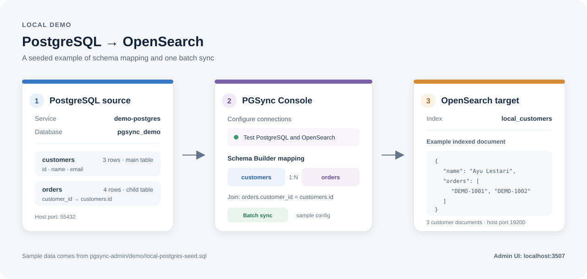

# PGSync Console

PGSync Console is a web application for configuring and operating database synchronization pipelines. The monorepo contains the Admin UI and API, PGSync-based runners, and a separate Search API.

The root Compose file starts the Admin UI and API. Search API has a separate Compose file. Database servers are supplied by the operator, except in the isolated local demo profile.

## Features

- Test source and destination connections before saving a pipeline.
- Discover tables, columns, and foreign-key relationships, then build a document mapping in Schema Builder.
- Run batch synchronization and continuous change capture for search pipelines.
- Configure PostgreSQL to ClickHouse analytics, continuous PostgreSQL replication, and PostgreSQL table copies.
- Monitor executions, logs, jobs, alerts, reports, and data lineage in the Admin UI.
- Search an OpenSearch index through the optional Search API.

Available pipeline modes and their requirements are documented in [the backend guide](pgsync-admin/backend/README.md#configure-pipeline-types).

## Run the Admin with Docker

Requirements: Docker Engine with Compose. Python 3 is optional and only used below to generate local secrets.

1. Create a private local environment file:

   ```sh
   cp .env.example .env
   ```

2. Generate `ENCRYPTION_KEY` and `JWT_SECRET`, then paste each result into `.env`:

   ```sh
   python3 -c 'import base64,secrets; print(base64.urlsafe_b64encode(secrets.token_bytes(32)).decode())'
   python3 -c 'import secrets; print(secrets.token_urlsafe(48))'
   ```

   Set `AUTH_ADMIN_USERNAME` and a unique `AUTH_ADMIN_PASSWORD` of at least 16 characters. Keep `DEMO_LOGIN_CREDENTIALS=false` except in an isolated local demo.

3. Build and start the Admin services:

   ```sh
   docker-compose -f docker-compose.yml up -d --build
   docker-compose -f docker-compose.yml ps
   ```

4. Open [http://localhost:3507](http://localhost:3507) and sign in. The API health endpoint is [http://localhost:3505/health](http://localhost:3505/health). Both ports bind to localhost.

The `backend-data` volume stores the Admin database. `down` keeps it; `down -v` deletes it.

## Try PostgreSQL to OpenSearch locally

The demo profile adds a seeded PostgreSQL database and a single-node OpenSearch instance. OpenSearch security is disabled and its port binds to localhost for this demo only. Do not use these settings on a shared or production network.

After completing the `.env` setup above, run:

```sh
docker-compose -f docker-compose.yml -f docker-compose.local-test.yml --profile local-test up -d --build
docker-compose -f docker-compose.yml -f docker-compose.local-test.yml --profile local-test ps
docker-compose -f docker-compose.yml -f docker-compose.local-test.yml --profile local-test exec -T backend /app/.venv/bin/python -m backend.scripts.local_pg_opensearch_smoke
```

The smoke test checks login, both connection handlers, schema and foreign-key discovery, configuration save/readback, PGSync batch execution, and indexed documents. See [the demo guide](pgsync-admin/demo/README.md) for sample credentials, ports, and reset instructions.



## Run Search API separately

Search API has a separate Compose definition and expects an OpenSearch endpoint configured in `.env`. The service uses TLS for its OpenSearch connection.

```sh
docker-compose --env-file .env -f search-api/docker-compose.yml up -d --build
curl http://localhost:18080/health
```

See [Search API documentation](search-api/README.md) for routes and request examples.

## Development and checks

Install `uv` and Node.js with npm, then install the Python workspace and frontend dependencies:

```sh
uv sync --all-packages
(cd pgsync-admin/frontend && npm ci)
```

Run the backend tests and frontend checks:

```sh
(cd pgsync-admin/backend && uv run pytest)
(cd pgsync-admin/frontend && npm run type-check && npm test && npm run build)
```

Run `make help` for the available Make targets. The root Compose file does not run a standalone PGSync CDC service; the Admin starts runners for configured pipelines. Search API is separate.

## Repository layout

| Path | Purpose |
| --- | --- |
| `pgsync-admin/backend/` | Robyn API, models, pipeline orchestration, and tests |
| `pgsync-admin/frontend/` | SolidJS Admin interface |
| `pgsync-admin/demo/` | Local PostgreSQL seed and demo instructions |
| `search-api/` | FastAPI search service and Docker configuration |
| `config/`, `plugins/`, `scripts/` | PGSync schemas, plugins, and utilities |
| `docs/` | Architecture, configuration, operations, deployment, and API references |

## Documentation

- [Documentation index](docs/README.md)
- [Quick start](QUICKSTART.md)
- [Deployment guide](docs/DEPLOYMENT.md)
- [Backend and pipeline requirements](pgsync-admin/backend/README.md)
- [Frontend](pgsync-admin/frontend/README.md)
- [Local PostgreSQL to OpenSearch demo](pgsync-admin/demo/README.md)
- [Search API](search-api/README.md)
- [CDC API reference](docs/CDC-API-REFERENCE.md)

## License

This project is distributed under the [MIT License](LICENSE).
