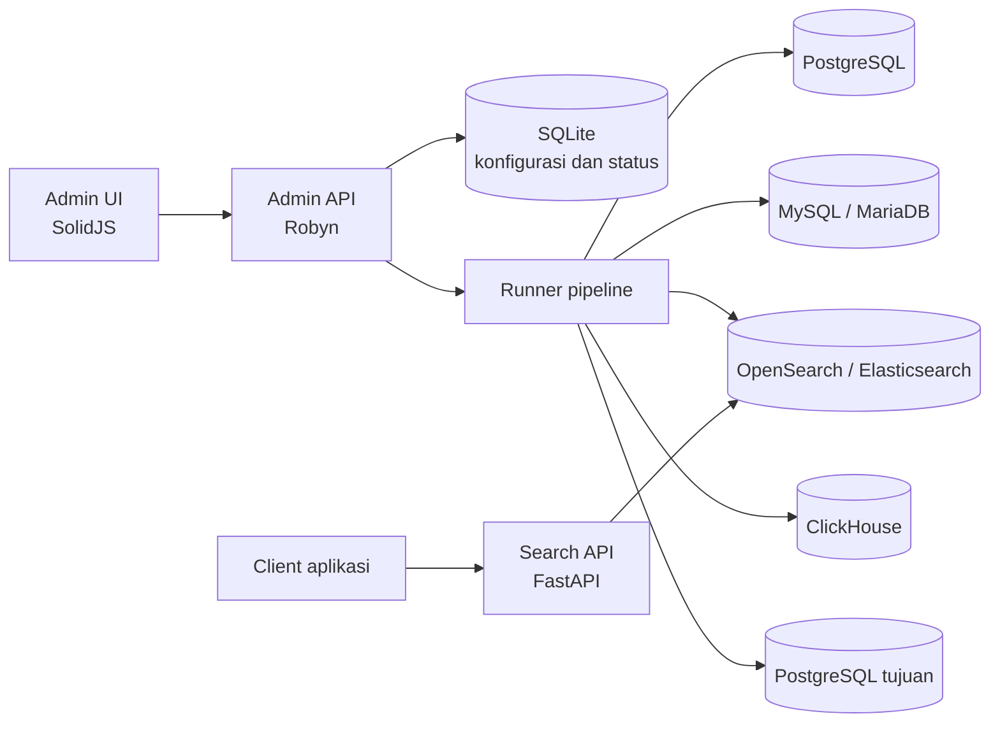

# Arsitektur

PGSync Console mengelola konfigurasi dan menjalankan pipeline sinkronisasi. Setiap pipeline membaca data dari sumber yang dipilih, mengubahnya sesuai pemetaan skema, lalu mengirim hasil ke tujuan.

## Komponen

- `pgsync-admin/frontend/`: antarmuka untuk koneksi, schema mapping, eksekusi, job, alert, laporan, dan lineage.
- `pgsync-admin/backend/`: API, SQLite untuk konfigurasi dan status, serta orkestrasi runner.
- `search-api/`: API pencarian terpisah yang membaca index OpenSearch.
- `config/`, `plugins/`, dan `scripts/`: contoh skema dan utilitas pipeline.

Compose utama hanya menjalankan Admin UI dan API. PostgreSQL, MySQL/MariaDB, OpenSearch, Elasticsearch, dan ClickHouse disediakan terpisah. Profil demo lokal menyediakan PostgreSQL dan OpenSearch contoh.

## Tipe pipeline

| Pipeline | Sumber → tujuan | Mode |
| --- | --- | --- |
| Search sync | PostgreSQL atau MySQL/MariaDB → OpenSearch atau Elasticsearch | Batch atau CDC |
| ClickHouse analytics | PostgreSQL → ClickHouse | Batch atau CDC sesuai connector |
| PostgreSQL replication | PostgreSQL → PostgreSQL | Logical replication berkelanjutan |
| PostgreSQL copy | PostgreSQL → PostgreSQL | Batch sekali jalan atau job terjadwal |

Batasan dan hak akses tiap mode ada di [panduan backend](../pgsync-admin/backend/README.md#configure-pipeline-types).
