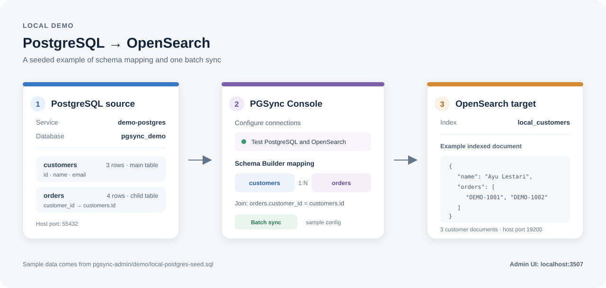

# Local PostgreSQL → OpenSearch sample

This isolated Compose overlay adds a seeded PostgreSQL source and a local OpenSearch node without changing the default Admin services. OpenSearch security is disabled for this localhost-only test profile; do not use these settings for a network-accessible deployment.

## Start the sample databases

From the repository root:

```sh
docker-compose -f docker-compose.yml -f docker-compose.local-test.yml --profile local-test up -d demo-postgres demo-opensearch
docker-compose -f docker-compose.yml -f docker-compose.local-test.yml --profile local-test ps
```

PostgreSQL is available from the host at `127.0.0.1:55432` and from the Admin container at `demo-postgres:5432`. OpenSearch is available from the host at `http://127.0.0.1:19200` and from the Admin container at `http://demo-opensearch:9200`.

Demo PostgreSQL credentials: database `pgsync_demo`, username `pgsync_demo`, password `pgsync_demo_password`. The seed creates three customers and four orders with a foreign key from `orders.customer_id` to `customers.id`.



## Run the connection and sync smoke test

The script logs in using the Admin credentials already configured in the backend container. It tests PostgreSQL and OpenSearch connections, discovers tables and the foreign key, creates or refreshes the sample configuration, runs PGSync batch execution, and checks that customer documents with related orders appear in OpenSearch.

```sh
docker-compose -f docker-compose.yml -f docker-compose.local-test.yml --profile local-test build backend demo-postgres
docker-compose -f docker-compose.yml -f docker-compose.local-test.yml --profile local-test up -d backend frontend demo-postgres demo-opensearch
docker-compose -f docker-compose.yml -f docker-compose.local-test.yml --profile local-test exec -T backend /app/.venv/bin/python -m backend.scripts.local_pg_opensearch_smoke
```

The sample configuration remains in the Admin UI at `http://localhost:3507/config` as `local_pg_to_opensearch_demo`. The smoke test does not delete configurations, indices, or database data.

## Check the form in the browser

Open the sample configuration and select **Edit**. The source password field is blank by design; enter `pgsync_demo_password` before pressing **Test connection**. For the destination, use host `demo-opensearch`, port `9200`, leave username/password empty, and turn off HTTPS before pressing **Test destination**. The Schema Builder sample is configured with `customers` as the main table and `orders` as its related table.

To stop only the demo services while retaining their data:

```sh
docker-compose -f docker-compose.yml -f docker-compose.local-test.yml --profile local-test stop demo-postgres demo-opensearch
```

To reset the seeded demo data, first stop the services, then remove only `pgsync-production_demo-postgres-data` and `pgsync-production_demo-opensearch-data`. Leave the Admin `backend-data` volume untouched.
